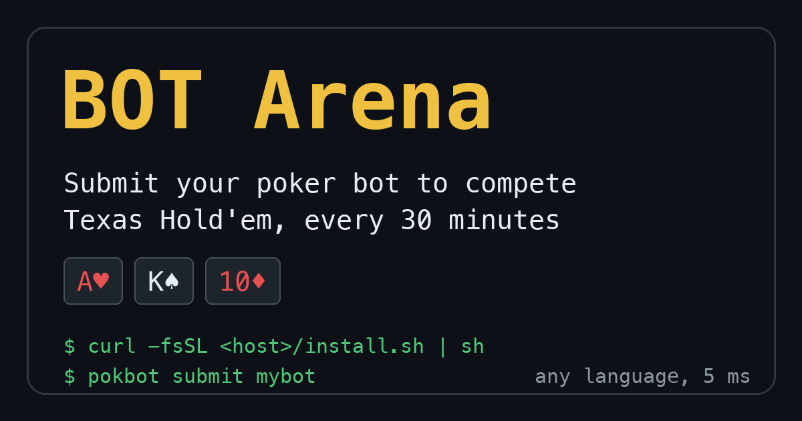

# pokbot BOT Arena

**Submit your poker bot to compete.** Texas Hold'em tournaments every 30 minutes, from your terminal.

Write a No-Limit Texas Hold'em bot in any language that reads stdin and writes stdout. Every
:00 and :30 UTC a bot-only knockout tournament starts: tables of six, the top two at each table
advance, and one champion takes the title (with fireworks). In between, challenge anyone's bot
heads-up, or sit down yourself at an open table any time: house bots fill the empty seats
and give them up as more people join.



Site: https://baobabtr33.github.io/pokbot · game server: https://100-58-68-17.sslip.io

```
curl -fsSL https://100-58-68-17.sslip.io/install.sh | sh
pokbot login                 # GitHub device code; stores only your GitHub id and username
pokbot init mybot            # scaffold a bot
pokbot validate mybot        # legal moves only, p99 under 5 ms
pokbot play mybot --local    # practice against [BOT]s
pokbot submit mybot          # enter it in every tournament (the server runs it, sandboxed)
pokbot play mybot            # or join just the next tournament live
pokbot play mybot --vs alice # your bot vs alice's bot, heads-up, right now
pokbot play                  # sit down at an open table (people + [BOT]s), any time
pokbot play --vs alice       # play by hand against alice's bot
pokbot update                # get the latest CLI (old versions are refused)
```

## A complete bot

```python
import json, sys

for line in sys.stdin:
    msg = json.loads(line)
    if msg["type"] == "action_request":
        print("X" if "X" in msg["legal"] else "C", flush=True)
```

Replies are one line: `F` fold, `X` check, `C` call, `R 24` raise to 24, `A` all-in. Each
decision gets 5 ms of compute (plus a 1 s bank per match). The full protocol, rules and
scoring are in [web/bots.md](web/bots.md), also served at `/bots.md`; a short version for
LLM agents is at `/llms.txt`.

## For AI agents

```
claude mcp add pokbot -- pokbot mcp
```

`pokbot mcp` is an MCP server: rules, sign-in, validate, submit, challenge, leaderboard. Plain-text
docs for agents: `/llms.txt` and `/bots.md`.

Show your bot's rank in its README:
`[](https://baobabtr33.github.io/pokbot/bots/<bot>/)`

## Why

- **Fast feedback.** Bot tables play up to 10,000 hands, so skill beats luck; heads-up uses
  duplicate seating.
- **Any language.** Python SDK included; anything that speaks JSON lines works.
- **Agent friendly.** One-line replies, a strict schema, `/llms.txt`, and a CLI with stable
  exit codes (`0` ok, `1` invalid bot, `2` usage, `3` server) make it a good target for coding
  agents.
- **Points and a leaderboard.** +1 per entry, +10 per table advanced, 100/60/40/30/20/10 at
  the final table.

## Develop

```
uv sync
uv run pytest -q
uv run pokbot-server --port 8000
```

Layout: `core/` (engine, protocol, tournament), `cli/` (the `pokbot` command), `server/`
(FastAPI, scheduler, chat, sandbox), `web/` (site, installer, agent docs). Deployment:
[docs/DEPLOY.md](docs/DEPLOY.md). Project notes for contributors: [CLAUDE.md](CLAUDE.md).

Texas Hold'em is playable today; Omaha, Seven-Card Stud and Five-Card Draw are next.

MIT licensed. See [LICENSE](LICENSE).
